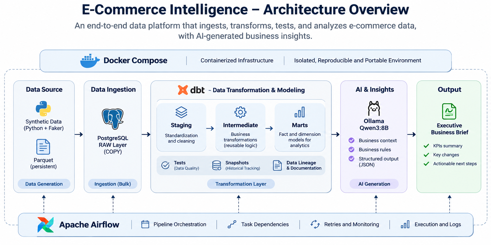
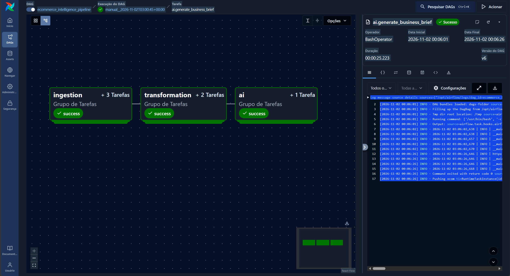

# E-commerce Intelligence Platform

> An end-to-end platform combining Data Engineering, Analytics Engineering and local Generative AI using synthetic e-commerce data.

## Overview

**Data generation → ingestion → transformation → data quality → analytics → AI interpretation → orchestration.**

The platform generates and incrementally maintains a multi-million-row synthetic e-commerce dataset, processes it through PostgreSQL and dbt, orchestrates the pipeline with Apache Airflow, and generates structured business insights with a local LLM.

## Architecture



- **Initial load:** Python generation → Parquet → CSV staging → PostgreSQL RAW (TRUNCATE + COPY).
- **Recurring pipeline:** incremental generation → CSV staging → PostgreSQL RAW (COPY + UPSERT) → dbt snapshots/build/tests → deterministic business rules → Ollama → validated JSON → PostgreSQL AI Business Briefs.

[Architecture source](docs/architecture/architecture-v1.md) · [Ingestion details](docs/ingestion.md) · [Airflow orchestration](docs/orchestration.md)

## Technology Stack

| Area | Technologies |
|---|---|
| Language and packaging | Python 3.12, uv |
| Data generation and storage | Faker, NumPy, Pandas, Parquet, CSV |
| Database | PostgreSQL 17, pgAdmin |
| Analytics Engineering | dbt, SQL, snapshots, data-quality tests |
| Orchestration | Apache Airflow |
| Infrastructure | Docker, Docker Compose |
| Business Intelligence | Streamlit |
| Local AI | Ollama, Qwen3 8B, JSON Schema |
| Tests and delivery | pytest, GitHub Actions, Git |

## Quick Start

Requirements: Python 3.12, uv, Docker Desktop / Docker Compose, Ollama and Git.

```bash
git clone https://github.com/LeonArmster/Projeto_Ecommerce_Intelligence.git
cd Projeto_Ecommerce_Intelligence
cp .env.example .env
uv sync
ollama pull qwen3:8b
docker compose up -d
```

Configure `.env` for your environment before running. The host Ollama endpoint is `http://localhost:11434`; Docker containers use `http://host.docker.internal:11434`.

**A fresh database requires the documented initial bootstrap/full-load workflow before incremental runs.** See [local setup](docs/setup.md) and [ingestion](docs/ingestion.md).

```bash
uv run dbt debug --project-dir dbt/ecommerce --profiles-dir dbt/profiles
uv run dbt build --project-dir dbt/ecommerce --profiles-dir dbt/profiles
```

Trigger `ecommerce_intelligence_pipeline` through the Airflow UI at `http://localhost:8080` after confirming the initial load. The DAG has a daily 06:00 schedule in its configured timezone; manual execution is also supported.

## Results and Evidence

- Initial synthetic dataset: approximately **6.4 million records** across seven entities (baseline estimate, not a live count).
- Successful end-to-end incremental Airflow execution, including dbt data-quality checks and local AI Business Brief persistence.
- One synchronized RAW incremental run: **0 affected rows across five tables in 10.75 seconds** (observed run, not a benchmark).
- AI uses validated metrics, deterministic rules, and structured JSON output rather than generating unsupported calculations.



*The screenshot documents a successful execution; task labels and settings may differ from the current incremental configuration.*

## V2 — Analytics Engineering & Business Intelligence

V2 adds dimensional models, customer behavior, product and logistics marts, repeat purchase metrics, monthly cohort retention and a lightweight consumption layer. A targeted dbt build passed all 153 selected nodes with both default and historical customer reference dates. Results use synthetic data and are not market benchmarks.

## Business Dashboard

A lightweight Streamlit dashboard consumes the dbt analytical marts. See [dashboard setup](dashboard/README.md).

## Documentation

- [Setup and local execution](docs/setup.md)
- [Synthetic data, bootstrap and incremental ingestion](docs/ingestion.md)
- [dbt staging, intermediate, marts, snapshots and tests](docs/dbt.md)
- [AI Business Brief, guardrails and persistence](docs/ai-layer.md)
- [Airflow DAG, end-to-end execution and observability](docs/orchestration.md)
- [Design decisions and known limitations](docs/limitations.md)
- [Status and long-term roadmap](docs/roadmap.md)
- [Engineering principles and vision](docs/principles.md)

## Releases and Roadmap

- [v1.0.0 — Initial End-to-End Data Platform](https://github.com/LeonArmster/Projeto_Ecommerce_Intelligence/releases/tag/v1.0.0)
- [Issues and planned improvements](https://github.com/LeonArmster/Projeto_Ecommerce_Intelligence/issues)
- [Project roadmap](docs/roadmap.md)

## License and Author

Synthetic data is used for educational and portfolio purposes. This section does not grant a software license; consult the repository for licensing terms.

**Leonardo de Souza Silva** — Data & Analytics professional focused on Analytics Engineering, Data Engineering, Machine Learning and AI-driven analytical solutions.
