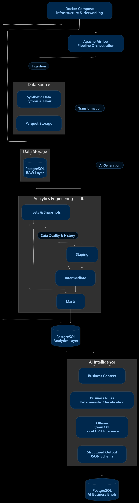
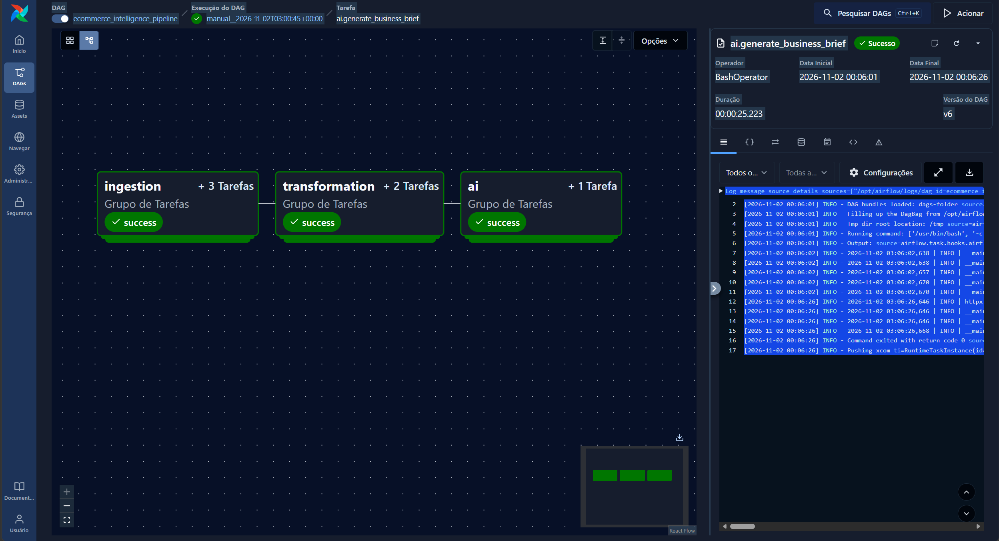

# E-commerce Intelligence Platform

> An end-to-end data platform combining Data Engineering, Analytics Engineering and Generative AI to transform e-commerce data into reliable analytical insights.

## Overview

The **E-commerce Intelligence Platform** is an end-to-end data project designed to simulate the architecture of a modern analytics platform.

The project covers the complete data lifecycle:

**Data Generation → Data Ingestion → Transformation → Data Quality → Analytics → AI Interpretation → Orchestration**

The platform generates a synthetic e-commerce dataset with millions of records, processes the data through an analytical pipeline built with PostgreSQL and dbt, orchestrates the workflow with Apache Airflow, and uses a local Large Language Model to generate structured business insights.

The central idea of the project is to separate three analytical responsibilities:

- **What happened?** → Analytics Engineering
- **What will happen?** → Machine Learning
- **What should be investigated?** → Artificial Intelligence

Version 1 focuses on building the analytical foundation and the first AI-powered business intelligence capability.

---

# Architecture

The V1 architecture follows this flow:


---

# Technology Stack

| Layer | Technology |
|---|---|
| Language | Python 3.12 |
| Dependency Management | uv |
| Database | PostgreSQL 17 |
| Analytics Engineering | dbt |
| Orchestration | Apache Airflow |
| Containerization | Docker / Docker Compose |
| Data Generation | Faker / NumPy / Pandas |
| Storage | Parquet / CSV |
| Local LLM Runtime | Ollama |
| Large Language Model | Qwen3 8B |
| AI Integration | Python / HTTP API |
| Structured AI Output | JSON Schema |
| Database Administration | pgAdmin |
| Version Control | Git / GitHub |

---

# Project Structure

```text
ecommerce-intelligence/
│
├── airflow/
│   └── dags/
│       └── ecommerce_pipeline.py
│
├── data/
│   ├── raw/
│   ├── processed/
│   └── samples/
│
├── dbt/
│   ├── ecommerce/
│   │   ├── analyses/
│   │   ├── macros/
│   │   ├── models/
│   │   │   ├── staging/
│   │   │   ├── intermediate/
│   │   │   └── marts/
│   │   ├── seeds/
│   │   ├── snapshots/
│   │   ├── tests/
│   │   └── dbt_project.yml
│   │
│   └── profiles/
│       └── profiles.yml
│
├── docker/
│   └── airflow/
│       ├── Dockerfile
│       └── requirements.txt
│
├── docs/
│
├── logs/
│
├── sql/
│
├── src/
│   └── ecommerce_intelligence/
│       ├── ai/
│       │   ├── llm/
│       │   ├── brief_repository.py
│       │   ├── business_brief.py
│       │   ├── business_context.py
│       │   ├── business_rules.py
│       │   └── schemas.py
│       │
│       ├── config/
│       ├── database/
│       ├── extract/
│       ├── generator/
│       ├── load/
│       └── transform/
│
├── tests/
│
├── .env.example
├── .gitignore
├── .python-version
├── compose.yml
├── Dockerfile
├── pyproject.toml
├── README.md
└── uv.lock
```

---

# Synthetic Dataset

The platform uses a synthetic e-commerce dataset so the entire project can be publicly reproduced without exposing proprietary or sensitive information.

The dataset contains seven main entities:

| Entity | Approximate Volume |
|---|---:|
| Customers | 100,000 |
| Products | 20,000 |
| Orders | 1,000,000 |
| Order Items | ~2,750,000 |
| Payments | 1,000,000 |
| Shipments | ~960,000 |
| Reviews | ~576,000 |

The complete dataset contains approximately **6.4 million records**.

The generator includes intentional relationships between variables to create realistic analytical patterns.

Examples include:

- demand seasonality;
- different customer purchasing profiles;
- shipping method impact on delivery performance;
- regional logistical complexity;
- delivery delays affecting customer ratings;
- discount effects on demand;
- category-specific price behavior.

The goal is not to perfectly reproduce a real e-commerce company, but to create a sufficiently complex environment for practicing Data Engineering, Analytics Engineering, Machine Learning and AI.

---

# Data Ingestion

The ingestion pipeline follows:

```text
Python Generator
      │
      ▼
Parquet
      │
      ▼
CSV Staging
      │
      ▼
PostgreSQL COPY
      │
      ▼
RAW Schema
```

Parquet is used as the persistent generated data format.

CSV files are temporarily created because PostgreSQL server-side `COPY` does not directly ingest Parquet files.

The Docker environment exposes the data directory to PostgreSQL so the database can perform high-performance bulk ingestion.

The RAW layer preserves the source structure before analytical transformations are applied.

---

# Analytics Engineering with dbt

dbt is responsible for transforming RAW data into reliable analytical models.

The transformation architecture follows three primary layers.

## Staging

The staging layer standardizes the source data.

Responsibilities include:

- column naming;
- data types;
- boolean normalization;
- timestamp normalization;
- basic validation;
- source tests.

Example models:

```text
stg_customers
stg_products
stg_orders
stg_order_items
stg_payments
stg_shipments
stg_reviews
```

---

## Intermediate

The intermediate layer contains reusable business transformations.

Examples:

### `int_order_items_enriched`

Enriches order items with product information and calculates:

- gross amount;
- discount amount;
- net amount.

### `int_order_items_aggregated`

Aggregates item-level information to one row per order.

### `int_shipments_enriched`

Calculates logistics metrics such as:

- delivery duration;
- delivery status;
- delay indicator.

### `int_orders_enriched`

Creates the central analytical order dataset by combining:

- customer;
- items;
- payments;
- shipments;
- reviews.

The model maintains a **one-row-per-order grain**.

---

# Analytical Marts

The marts layer contains datasets designed for analytical consumption.

## `fct_orders`

Incremental order fact table.

Main characteristics:

- unique `order_id`;
- incremental materialization;
- merge strategy;
- rolling lookback window to capture recent changes.

---

## `fct_daily_sales`

Daily business performance fact table.

Example metrics:

- total orders;
- valid orders;
- cancelled orders;
- customers;
- units sold;
- gross sales;
- discounts;
- net sales;
- delivered orders;
- delayed orders;
- reviewed orders;
- average rating;
- average order value;
- cancellation rate;
- delay rate;
- review rate.

Ratios are calculated using a reusable `safe_divide` dbt macro.

---

## Business Daily Summary

A dedicated analytical mart prepares metrics used by the AI layer.

It calculates comparisons such as:

```text
net_sales_change_pct
orders_change_pct
avg_order_value_change_pct

cancellation_rate_change_pp
delay_rate_change_pp

avg_rating_change
```

Metric naming follows a semantic contract:

| Suffix | Meaning |
|---|---|
| `_amount` | Monetary value |
| `_orders` | Count |
| `_rate` | Decimal rate |
| `_change_pct` | Relative percentage change |
| `_change_pp` | Percentage-point change |
| `_change` | Absolute change |

This semantic convention reduces ambiguity between the analytical and AI layers.

---

# Data Quality

Data quality is integrated directly into the dbt workflow.

The project uses tests such as:

- `not_null`;
- `unique`;
- relationships;
- accepted values;
- grain validation;
- arithmetic validation;
- business-rule validation.

Because `dbt build` executes models and their associated tests, the pipeline does not require a redundant standalone quality TaskGroup in V1.

Conceptually:

```text
Transformation
      │
      ▼
dbt build
      │
      ├── models
      └── tests
             │
             ▼
        tests passed?
          │      │
         YES     NO
          │      │
          ▼      ▼
         AI    Pipeline fails
```

The AI layer therefore only executes after the analytical models have successfully passed the configured data-quality checks.

---

# dbt Snapshots

Snapshots are used to preserve historical changes in mutable business entities.

The V1 implementation tracks changes in order status.

This introduces Slowly Changing Dimension concepts and allows historical analysis even when source records change over time.

---

# AI Business Intelligence Layer

The first AI capability of the platform is the **AI Business Brief**.

Its purpose is to transform validated business metrics into a concise executive interpretation.

The architecture deliberately separates deterministic computation from generative interpretation.

```text
dbt
 │
 ├── calculates metrics
 └── calculates variations
          │
          ▼
Business Context
          │
          ▼
Business Rules
 │
 ├── direction
 └── severity
          │
          ▼
LLM
 │
 ├── interpretation
 ├── synthesis
 └── investigation recommendations
          │
          ▼
Structured Output
```

The LLM does **not** calculate core business metrics.

Those calculations belong to the analytical platform.

---

# Business Context

The Business Context layer retrieves validated metrics from PostgreSQL and prepares them for AI consumption.

It contains three categories of information:

```text
context
│
├── metrics
│   ├── net_amount
│   ├── valid_orders
│   ├── delay_rate
│   └── ...
│
├── metadata
│   ├── analysis_granularity
│   └── comparison_type
│
└── deterministic signals
    └── metric_signals
        ├── direction
        └── severity
```

For V1:

```text
analysis_granularity = daily
comparison_type = previous_day
```

This prevents the LLM from incorrectly inferring temporal granularity.

---

# Deterministic Business Rules

Not every analytical decision should be delegated to an LLM.

Metric direction and severity are calculated deterministically in Python.

Example:

```json
{
  "metric": "delay_rate_change_pp",
  "value": -2.83,
  "direction": "down",
  "severity": "medium"
}
```

This design provides reproducibility.

The same metric variation always produces the same classification regardless of which LLM is being used.

The LLM is responsible for **interpretation**, not deterministic classification.

---

# Local LLM with Ollama

The project uses **Ollama** as the local LLM runtime.

Current model:

```text
Qwen3 8B
```

Benefits of local inference for this project include:

- no API inference cost;
- local experimentation;
- data remains within the local environment;
- provider-independent architecture;
- GPU acceleration.

The development machine can use an NVIDIA GPU for local inference.

The architecture does not depend directly on Ollama.

Instead, the application uses an LLM provider abstraction.

```text
Business Brief
      │
      ▼
LLMProvider
      │
      ├── Ollama
      │
      ├── Future Databricks Provider
      │
      └── Future Cloud Provider
```

This makes the AI layer replaceable without changing the analytical pipeline.

---

# Docker to Ollama Communication

Airflow runs inside Docker while Ollama runs on the host machine.

The communication path is:

```text
Airflow Container
       │
       ▼
host.docker.internal
       │
       ▼
Host Machine
       │
       ▼
Ollama :11434
       │
       ▼
Qwen3 8B
```

Docker Compose maps the host gateway so containers can resolve:

```text
host.docker.internal
```

The Ollama endpoint used by Airflow is therefore:

```text
http://host.docker.internal:11434
```

while local Python development can use:

```text
http://localhost:11434
```

The application code remains unchanged because the endpoint is controlled through environment variables.

---

# Structured AI Output

The AI does not return arbitrary free-form text.

A JSON Schema defines the expected response contract.

Conceptually:

```json
{
  "executive_summary": "...",
  "signals": [
    {
      "metric": "delay_rate_change_pp",
      "description": "..."
    }
  ],
  "attention_points": [
    "..."
  ],
  "investigations": [
    "..."
  ]
}
```

Structured output makes AI responses usable by software rather than only readable by humans.

The result can therefore be:

- stored in PostgreSQL;
- exposed through an API;
- displayed in a dashboard;
- consumed by another application;
- compared across different LLM providers.

---

# AI Guardrails

The Business Brief prompt follows explicit analytical constraints.

The model must:

- use only provided indicators;
- avoid recalculating validated metrics;
- avoid inventing information;
- avoid unsupported causal claims;
- distinguish facts from hypotheses;
- respect percentage and percentage-point semantics;
- respect the provided temporal granularity;
- recommend investigations rather than invent conclusions.

For example, instead of claiming:

> Delivery performance improved because the logistics team implemented a new process.

the expected behavior is:

> Delivery performance improved compared with the previous period. The available indicators do not identify the cause of this change, so additional investigation is required.

This distinction is fundamental to the AI architecture of the project.

---

# AI Persistence and Traceability

Generated Business Briefs are stored in PostgreSQL.

The `ai.business_briefs` table stores:

```text
reference_date
provider
model_name
context_data
brief_data
generation_duration_seconds
generated_at
```

Both the analytical context and AI output are stored as JSONB.

This provides traceability:

```text
Which data was used?
        │
        ▼
Which business rules were applied?
        │
        ▼
Which provider generated the result?
        │
        ▼
Which model was used?
        │
        ▼
What output was generated?
```

This architecture also makes future model comparisons possible.

---

# Idempotency

AI persistence is designed to support retries safely.

The logical key is:

```text
reference_date
+
provider
+
model_name
```

The PostgreSQL persistence layer uses an UPSERT strategy.

Therefore, retrying the same execution updates the existing Business Brief instead of creating duplicate records.

This is especially important when the AI task runs under Airflow retry policies.

---

# Apache Airflow Orchestration

Apache Airflow orchestrates the complete workflow.

The V1 DAG is organized into three TaskGroups:

```text
INGESTION
    │
    ├── generate_data
    ├── prepare_staging
    └── load_raw
            │
            ▼
TRANSFORMATION
    │
    ├── dbt_build
    └── dbt_snapshot
            │
            ▼
AI
    │
    └── generate_business_brief
```

The dependency is:

```text
ingestion >> transformation >> ai
```

The AI stage only executes after the transformation stage succeeds.

Since `dbt build` includes the configured data-quality tests, a failed critical test prevents the downstream AI stage from executing normally.

The complete V1 pipeline is orchestrated by Apache Airflow:



The screenshot above shows a successful end-to-end execution of the
pipeline, from data ingestion through analytical transformation to
AI Business Brief generation.

---

# End-to-End Execution

A successful V1 execution performs the complete flow:

```text
Generate millions of synthetic records
                │
                ▼
        Prepare staging files
                │
                ▼
       Load PostgreSQL RAW
                │
                ▼
         Execute dbt models
                │
                ▼
         Execute dbt tests
                │
                ▼
          Update snapshots
                │
                ▼
      Build analytical context
                │
                ▼
     Apply deterministic rules
                │
                ▼
        Call local Qwen3 8B
                │
                ▼
       Validate structured output
                │
                ▼
     Persist AI Business Brief
```

The complete workflow has been successfully executed through Apache Airflow.

---

# Observability

V1 intentionally uses lightweight observability rather than introducing additional infrastructure such as Prometheus, Grafana or OpenTelemetry.

Three existing components provide the required operational visibility.

## Airflow

Provides:

- DAG status;
- task status;
- execution duration;
- retries;
- execution history;
- task logs.

## dbt

Provides:

- model execution status;
- test results;
- transformation failures;
- data-quality validation.

## PostgreSQL

Stores AI execution metadata:

- reference date;
- provider;
- model;
- generation timestamp;
- inference duration;
- analytical context;
- generated response.

Python applications use structured logging to `stdout`, allowing Airflow to capture execution logs directly.

---

# Environment Configuration

Create a `.env` file based on `.env.example`.

Example:

```dotenv
POSTGRES_HOST=localhost
POSTGRES_PORT=5432
POSTGRES_DB=ecommerce
POSTGRES_USER=ecommerce
POSTGRES_PASSWORD=ecommerce

PGADMIN_EMAIL=admin@admin.com
PGADMIN_PASSWORD=admin

LLM_PROVIDER=ollama
OLLAMA_MODEL=qwen3:8b
OLLAMA_BASE_URL=http://localhost:11434
```

Inside Docker, the Ollama endpoint must point to the host:

```text
http://host.docker.internal:11434
```

Never commit real credentials or secrets to Git.

---

# Local Development Setup

## Requirements

Recommended environment:

- Python 3.12
- uv
- Docker Desktop
- Docker Compose
- Ollama
- Git

For GPU-accelerated local inference, a compatible NVIDIA GPU is recommended but not required for understanding the architecture.

---

## Python Environment

Create the environment:

```bash
uv sync
```

Activate it on Windows PowerShell:

```powershell
.venv\Scripts\Activate.ps1
```

---

# Ollama Setup

Install Ollama and download the model:

```bash
ollama pull qwen3:8b
```

Verify the model:

```bash
ollama list
```

The local API should be available at:

```text
http://localhost:11434
```

---

# Start the Platform

Start the Docker services:

```bash
docker compose up -d
```

Check containers:

```bash
docker compose ps
```

The environment includes services for:

- PostgreSQL;
- pgAdmin;
- Airflow metadata database;
- Airflow scheduler;
- Airflow API/web services.

---

# Running dbt

Validate the dbt connection:

```bash
uv run dbt debug \
  --project-dir dbt/ecommerce \
  --profiles-dir dbt/profiles
```

Build analytical models and run tests:

```bash
uv run dbt build \
  --project-dir dbt/ecommerce \
  --profiles-dir dbt/profiles
```

Run snapshots:

```bash
uv run dbt snapshot \
  --project-dir dbt/ecommerce \
  --profiles-dir dbt/profiles
```

---

# Running the AI Business Brief Locally

The Business Brief can be executed independently:

```bash
uv run python -m ecommerce_intelligence.ai.business_brief
```

This process:

1. reads validated analytical metrics;
2. builds the business context;
3. applies deterministic business rules;
4. calls the configured LLM provider;
5. validates the structured output;
6. persists the result in PostgreSQL.

---

# Running through Airflow

The primary execution method for the complete V1 pipeline is Apache Airflow.

The DAG is:

```text
ecommerce_intelligence_pipeline
```

During development, the pipeline can be triggered manually through the Airflow interface.

The current V1 pipeline intentionally uses manual execution while the ingestion architecture still performs full synthetic-data generation and RAW loading.

A production-style recurring schedule should only be introduced after the ingestion strategy becomes incremental.

---

# Design Decisions

Several architectural decisions are intentional.

## Why PostgreSQL?

PostgreSQL provides a realistic relational analytical environment while remaining easy to run locally with Docker.

It also supports JSONB, which is useful for AI context and response persistence.

## Why Parquet and CSV?

Parquet is the persistent generated-data format.

CSV is used only as an ingestion staging format for PostgreSQL server-side `COPY`.

## Why dbt?

dbt separates analytical transformations from Python ingestion logic and provides:

- modular SQL transformations;
- lineage;
- tests;
- documentation;
- incremental models;
- snapshots.

## Why Airflow?

Airflow provides explicit dependency management, retries, execution history and observability for the complete pipeline.

## Why local AI?

The goal of V1 is to learn AI integration without requiring paid inference APIs.

Ollama allows local experimentation while preserving a provider-independent application architecture.

## Why not let the LLM calculate metrics?

LLMs are probabilistic systems.

Business metrics require deterministic and reproducible calculations.

Therefore:

```text
dbt / Python
     ↓
deterministic computation

LLM
     ↓
interpretation and communication
```

## Why no dedicated Quality TaskGroup?

Data-quality tests are already executed by `dbt build`.

Adding another TaskGroup that only repeated the same validations would add visual complexity without providing additional protection.

## Why no cloud yet?

Cloud infrastructure is intentionally postponed until the local architecture is stable.

This avoids introducing infrastructure cost and complexity before the analytical design is validated.

---

# Known Limitations and Technical Debt

The synthetic dataset intentionally remains an evolving component.

Known areas for future improvement include:

- customer creation dates should be fully consistent with order chronology;
- historical orders should have more realistic status behavior;
- duplicate products within the same order should be controlled;
- ingestion is currently based on full regeneration/loading rather than a true daily incremental source;
- AI severity thresholds are demonstration business rules rather than universal e-commerce standards;
- local Ollama inference depends on the host machine being available when the Airflow AI task executes.

These limitations are documented rather than hidden because identifying and managing technical debt is part of the project.

---

# V1 Status

Version 1 establishes the platform foundation.

Completed capabilities include:

- synthetic data generation;
- multi-million-row dataset;
- Parquet storage;
- PostgreSQL bulk ingestion;
- dbt staging models;
- dbt intermediate models;
- analytical marts;
- dbt data-quality tests;
- incremental models;
- dbt snapshots;
- Docker environment;
- Apache Airflow orchestration;
- local LLM integration;
- provider abstraction;
- deterministic AI business rules;
- structured AI output;
- PostgreSQL AI persistence;
- idempotent AI writes;
- Docker-to-host Ollama communication;
- end-to-end pipeline execution;
- basic operational observability.

---

# Roadmap

The project is designed to evolve incrementally rather than adding technologies without a business purpose.

## V1 — Data Platform + AI Foundation

**Status: Complete**

Focus:

- Data Engineering;
- Analytics Engineering;
- orchestration;
- data quality;
- local Generative AI;
- structured business interpretation.

---

## V2 — Advanced Analytics Engineering

Planned topics:

- dimensional modeling;
- `dim_customers`;
- `dim_products`;
- `dim_date`;
- additional fact tables;
- customer behavior marts;
- product performance marts;
- logistics marts;
- advanced incremental strategies;
- SCD patterns;
- dbt macros;
- generic tests;
- singular tests;
- contracts;
- source freshness;
- exposures;
- improved synthetic-data integrity.

---

## V3 — Machine Learning: Delivery Risk

Goal:

> Predict the probability that an order will be delivered late.

Planned components:

```text
dbt Feature Mart
      ↓
Training Dataset
      ↓
ML Training
      ↓
Experiment Tracking
      ↓
Model
      ↓
Predictions
      ↓
Explainability
```

Potential technologies:

- scikit-learn;
- XGBoost;
- CatBoost;
- MLflow;
- SHAP.

---

## V4 — Customer Intelligence

Potential capabilities:

- RFM analysis;
- customer segmentation;
- customer behavior features;
- repeat-purchase propensity;
- customer lifetime value;
- customer profiles.

---

## V5 — AI Data Analyst

The current Business Brief is intentionally limited to interpreting predefined metrics.

A future AI Analyst will be able to investigate analytical questions using controlled tools.

Example:

```text
User:
"Why did sales decrease?"

        ↓

AI Analyst

        ├── investigates categories
        ├── investigates regions
        ├── investigates customers
        ├── investigates logistics
        └── compares periods

        ↓

Evidence-based synthesis
```

Planned concepts:

- tool calling;
- semantic context;
- controlled analytical tools;
- context engineering;
- AI guardrails.

---

## V6 — Application Layer

Expose the platform through an application.

Potential architecture:

```text
Frontend
   │
   ▼
FastAPI
   │
   ├── Analytics
   ├── Machine Learning
   └── AI
          │
          ▼
      PostgreSQL
```

Potential deployment options include Supabase for lightweight public data access.

---

## V7 — Databricks / Lakehouse

The same project will later be adapted to a Lakehouse architecture.

Potential architecture:

```text
Object Storage
      ↓
Bronze
      ↓
Silver
      ↓
Gold
      ↓
Delta Lake
```

Planned technologies:

- PySpark;
- Delta Lake;
- Databricks;
- MLflow;
- Unity Catalog;
- Databricks Workflows;
- Model Serving.

The synthetic dataset can also be scaled from millions to tens or hundreds of millions of records to create a workload where distributed processing has a clear technical purpose.

---

## V8 — Azure Cloud Architecture

Final infrastructure evolution may include:

- Azure Data Lake Storage;
- Azure Databricks;
- secrets and identity management;
- cloud networking;
- deployment;
- monitoring;
- cost management;
- CI/CD.

Cloud resources will be introduced only when they provide a clear architectural learning objective.

---

# Engineering Principles

The project follows a few core principles.

### Data first

AI and ML depend on reliable analytical foundations.

### Deterministic calculations belong outside the LLM

Metrics, classifications and business rules should be reproducible whenever possible.

### AI should interpret evidence, not invent it

The LLM receives validated analytical context and operates under explicit constraints.

### Orchestration should reflect real dependencies

AI executes only after analytical transformations and data-quality checks succeed.

### Complexity must have a reason

New technologies are introduced only when the project reaches a problem that justifies them.

### Technical debt should be visible

Known limitations are documented and addressed incrementally.

---

# Project Vision

The long-term goal is to build a platform capable of answering three increasingly complex questions:

```text
                 BUSINESS DECISION

                        │
            ┌───────────┼───────────┐
            ▼           ▼           ▼

      What happened?  What will   What should
                       happen?     we investigate?

            │           │           │
            ▼           ▼           ▼

       Analytics       ML          AI

            └───────────┼───────────┘
                        ▼

                   DATA PLATFORM
```

Rather than treating Analytics Engineering, Machine Learning and Generative AI as isolated projects, the platform demonstrates how these disciplines can operate on top of the same reliable data foundation.

---

# License

This project uses synthetic data generated specifically for educational and portfolio purposes.

Add the repository license here before public release.

---

# Author

**Leonardo de Souza Silva**

Data & Analytics professional focused on Analytics Engineering, Data Engineering, Machine Learning and AI-driven analytical solutions.

This project was developed as a practical environment for building and evolving a modern end-to-end data platform.