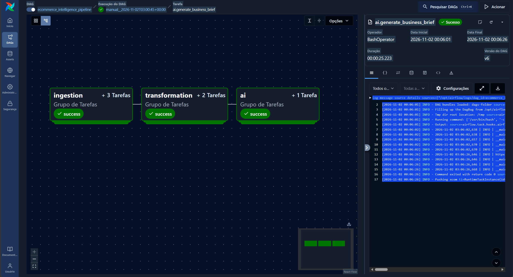

# Airflow Orchestration and Observability

## Apache Airflow Orchestration

Apache Airflow orchestrates the complete workflow using the **LocalExecutor** in Docker Compose. The DAG is `ecommerce_intelligence_pipeline` and is organized into three TaskGroups:

```text
INGESTION
    generate_data (incremental)
          ↓
    prepare_staging
          ↓
    load_raw (task ID retained; executes load_upsert.py)
          ↓
TRANSFORMATION
    dbt_snapshot
          ↓
    dbt_build (models + configured tests)
          ↓
AI
    generate_business_brief
```

The TaskGroup dependency is `ingestion >> transformation >> ai`. The AI stage runs only after successful dbt transformation and configured data-quality tests.

The DAG uses retry policies and task-level logs for observability. Its recurring schedule is configured as `0 6 * * *` (daily at 06:00 **in the DAG's configured timezone**; check timezone settings before enabling automatic runs). Manual DAG runs are also supported and were used to validate the complete incremental workflow.

The existing Airflow task ID `ingestion.load_raw` was preserved for compatibility, although its command now invokes `ecommerce_intelligence.load.load_upsert` rather than the initial full-load module.



> The screenshot documents an end-to-end execution. Task labels and scheduling settings may differ from the latest incremental configuration if the image has not yet been refreshed.

---

## End-to-End Execution

A successful recurring execution performs the complete flow:

```text
Generate new synthetic records and update pending events
                          ↓
               Persist Parquet datasets
                          ↓
                  Prepare CSV staging
                          ↓
             Load PostgreSQL RAW via UPSERT
                          ↓
                 Execute dbt snapshots
                          ↓
             Build dbt models and run tests
                          ↓
                 Build business context
                          ↓
               Apply deterministic rules
                          ↓
                   Call local Qwen3 8B
                          ↓
              Validate structured output
                          ↓
               Persist AI Business Brief
```

The complete incremental workflow has been tested successfully through Apache Airflow. Initial full loading remains available as a separate bootstrap operation.

---

## Observability

V1 intentionally uses lightweight observability rather than introducing additional infrastructure such as Prometheus, Grafana or OpenTelemetry.

Three existing components provide the required operational visibility.

## Airflow

Provides:

- DAG status;
- task status;
- execution duration;
- retries;
- execution history;
- task logs.

## dbt

Provides:

- model execution status;
- test results;
- transformation failures;
- data-quality validation.

## PostgreSQL

Stores AI execution metadata:

- reference date;
- provider;
- model;
- generation timestamp;
- inference duration;
- analytical context;
- generated response.

Python applications use structured logging to `stdout`, allowing Airflow to capture execution logs directly.

---
